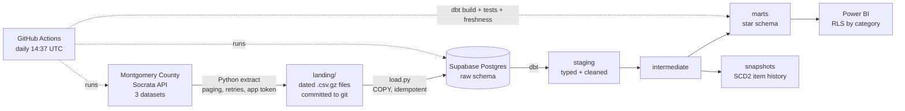

# Wine Inventory & Replenishment Pipeline — Montgomery County ABS

> **Status: in progress.** Pipeline and data model are built. Findings and recommendations get filled in as each hypothesis is tested.
> Sections marked _TODO_ are placeholders and contain no claims.

## Executive summary (30 seconds)

_TODO: write last. Three sentences: the decision, the headline number, the recommendation._

**What this project demonstrates:** Python API extraction (Socrata) · scheduled GitHub Actions pipeline ·
Postgres (Supabase) · dbt staging/intermediate/marts, SCD2 snapshots, incremental models, tests and source
freshness · star-schema modeling · Power BI with row-level security · a documented data-quality log.

## The business question

Montgomery County, MD runs its own alcohol wholesale and retail business, Alcohol Beverage Services (ABS).
It supplies licensed bars, restaurants and shops, and runs its own retail stores. Holiday orders go out in
October–November. **Which wine items should ABS reorder, hold or cut, and where is inventory out of line with demand?**

### Hypotheses (tested, not assumed)

| # | Hypothesis | Test | Result |
|---|---|---|---|
| H1 | County-store wine sales fell while licensee sales held | Matched-month comparison, Jun–Aug 2019 vs 2026 | Observed: stores −43%, licensees −16% (descriptive; cause not tested) |
| H2 | Store inventory is out of line with store sales for a subset of items | Months of supply by item | _Blocked: inventory unit (data-quality log #7)_ |
| H3 | Transfers to stores are not keeping up with store sales | Transfers vs sales by item and month | _TODO_ |
| H4 | Wine supply is concentrated in a few suppliers | Supplier share and HHI, 2019 vs 2026 | _TODO_ |
| H5 | The store decline comes from carrying fewer items, not lower sales per item | Like-for-like decomposition (self-join) | _TODO_ |
| H6 | Purchase orders follow demand | Rank correlation of purchases vs demand | _TODO_ |

## Architecture



| Layer | Tool | Notes |
|---|---|---|
| Extract | Python (`requests`) | `extract/extract.py`. Skips datasets the county hasn't changed (`rowsUpdatedAt`) |
| Landing | gzipped CSV in git | Inventory and purchases are overwritten upstream, so these files are the only history |
| Storage | Postgres on Supabase | `raw` schema, all text, one transaction per file |
| Transform | dbt | `staging` → `intermediate` → `marts`, plus `snapshots` |
| Quality | dbt tests, source freshness | 50+ tests; the job fails if inventory is >2 days stale |
| Present | Power BI | Connects to `marts` only |

Data model: [docs/erd.md](docs/erd.md)

## Data sources

| Dataset | Socrata ID | Upstream behavior | Grain | Units |
|---|---|---|---|---|
| Warehouse and Retail Sales | `v76h-r7br` | Appended monthly | item × month | cases (documented) |
| Product Purchases by DLC | `kpfd-c5d5` | **Overwritten** monthly (last month only) | PO line | cases (documented) |
| ABS Store Inventory and Sale Items | `ib5t-5ncy` | **Overwritten** daily | item (county total) | undocumented |

## Data-quality log

19 issues logged so far. Full table with detection method and decision: [docs/data_quality_log.md](docs/data_quality_log.md).
Highlights:
- Inventory and purchases are overwritten upstream. History exists only because this pipeline saves it daily.
- 5,941 item codes changed supplier or description over time. Handled with an SCD2 snapshot and supplier-at-time on facts.
- Sales history has a 5½-year gap (Oct 2020–May 2026). Not imputed; comparisons use matched months.
- The inventory quantity unit is undocumented and appears to differ from sales (cases). Still open.

## Findings

_TODO: one subsection per hypothesis. Each one: the chart, the number, what it means. Unexpected results are kept._

## Recommendations

_TODO: written for a merchandising or supply-chain manager. Each one states an action, the items it applies to, and the expected impact, with a number._

## Limitations

- **Inventory history:** the daily pull started on **_TODO: date of first successful run_**. On that date
  there were 0 days of inventory history, plus 1 backfilled manual export (2026-10-08). After one month
  there are about 30 daily snapshots. Anything based on inventory trends is limited to that window.
- **Purchases history:** one month at a time upstream. History = months collected since launch, plus 1 backfilled month (Sep 2026).
- **No store-level data:** inventory is a county-wide total, so there's no store analysis and no store-based RLS.
- **Sales gap:** no data Oct 2020–May 2026 (plus earlier missing months), so no trend can be drawn across it.
- **Inventory unit:** undocumented (see log #7). Months-of-supply figures depend on the resolved unit.
- **No cost or margin:** prices are retail prices only, so inventory value is stated at retail.

## Repository layout

```
.github/workflows/daily_pipeline.yml   scheduled job
extract/        Socrata client, extract, load, CSV backfill
landing/        dated raw files (inventory, purchases); sales is re-pullable and not committed
dbt/            models/{staging,intermediate,marts}, snapshots, seeds, tests
data/manual_exports/  original CSVs downloaded by hand from the county portal (kept as-is)
powerbi/        .pbix and RLS notes
docs/           SETUP.md, data_quality_log.md, erd.md
```

## Run it

Step-by-step setup (GitHub Actions, Supabase, local runs): [docs/SETUP.md](docs/SETUP.md)
