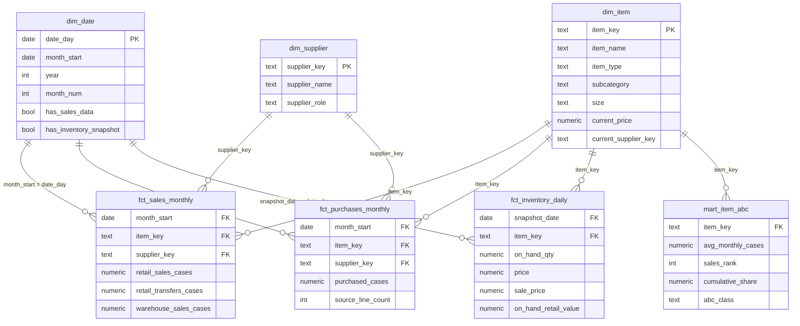

# Data model (star schema)

> **Status: draft.** Built from the joins tested so far (item codes match across all three sources;
> 232 of 235 purchase vendors match a sales supplier exactly). Re-draw after the full API profiling pass.
> There is **no store dimension**: none of the three sources has a store column (data-quality log #11).

## Grain and units

| Table | Grain | Units | Type |
|---|---|---|---|
| `fct_sales_monthly` | item × supplier × month | cases | transaction (monthly) |
| `fct_purchases_monthly` | item × vendor × month | cases | transaction (monthly) |
| `fct_inventory_daily` | item × day | **undocumented** (log #7) | periodic snapshot |
| `snapshots.snap_item_attributes` | item × version | — | SCD type 2 |

Power BI connects to the `marts` schema only. Relationships are one-to-many, single direction, dimension → fact.
